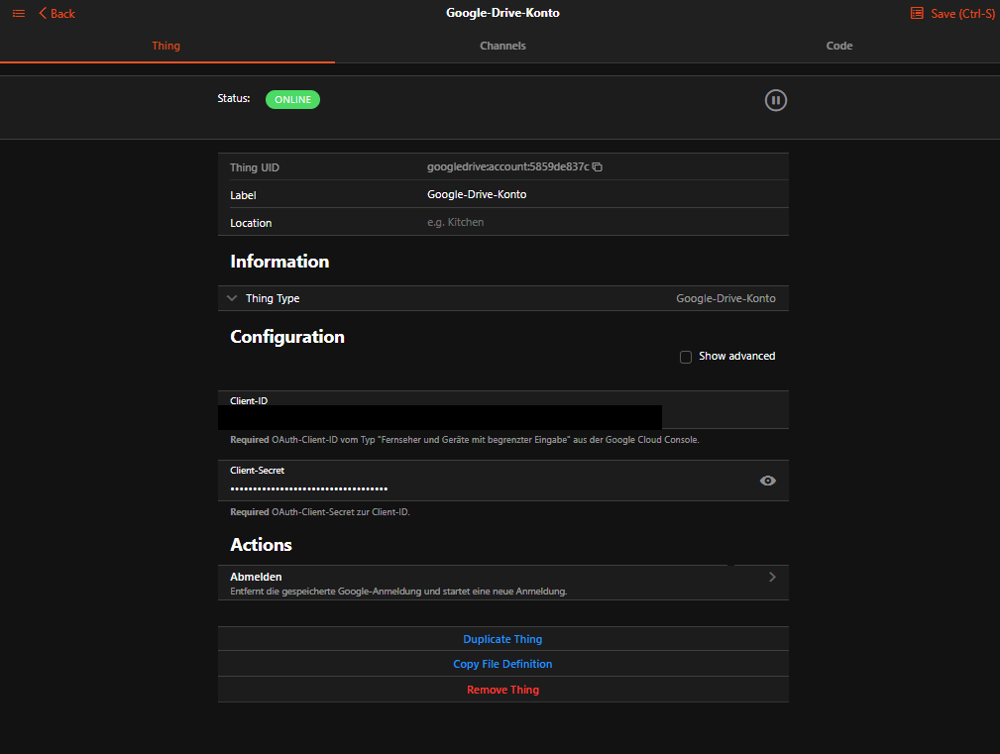
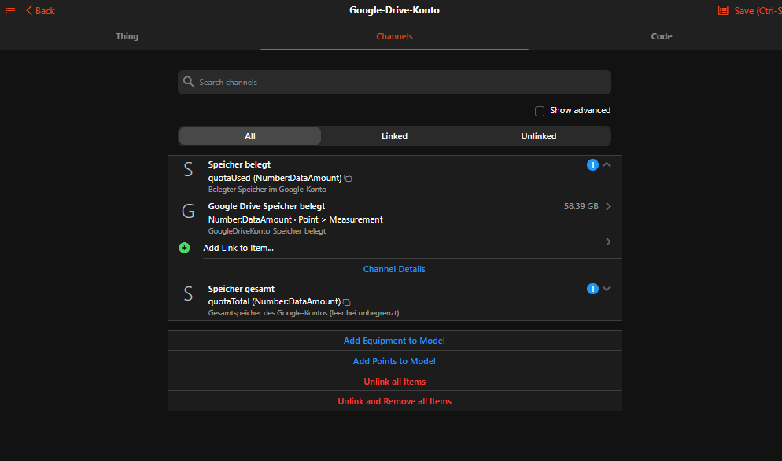
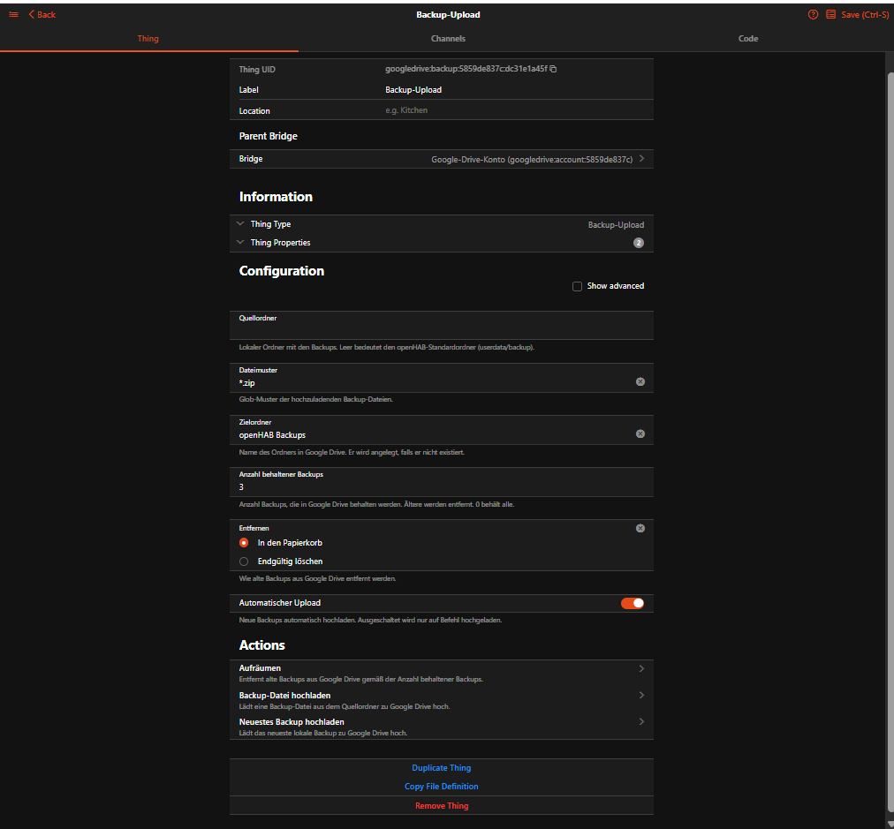
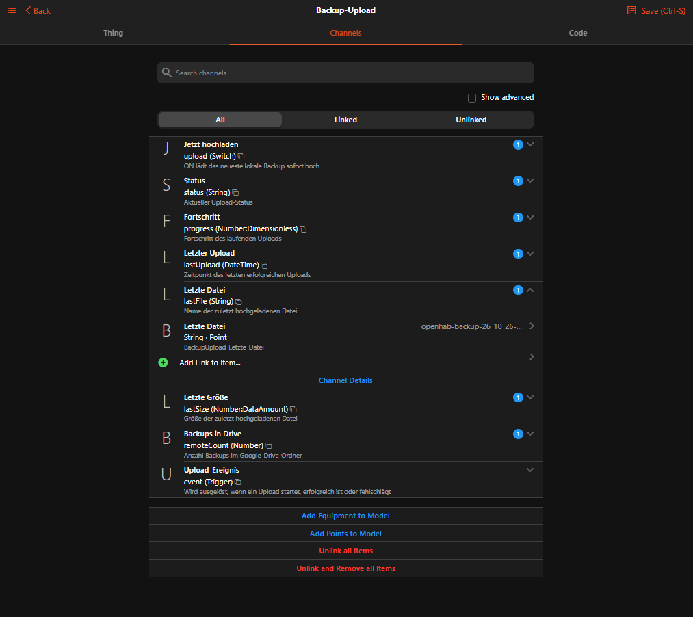
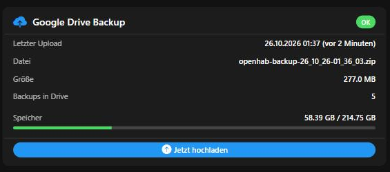

# Google Drive Binding

This binding uploads openHAB backups to [Google Drive](https://drive.google.com) and removes old backups there.

openHAB already creates backups in `userdata/backup` (for example with a rule that runs the backup script).
The binding watches that folder and uploads every new backup file to a folder in your Google Drive.
Everything is configured in the openHAB UI: no shell scripts, no rclone, no sudo rules.

- Login with a device code on google.com/device, no HTTPS or port forwarding needed
- Automatic upload of new backups, resumable for large files
- Keeps the last _N_ backups in Google Drive, older ones go to the trash
- Status, progress and events as channels, rule actions for manual uploads
- Minimal permission: the binding can only see the files it created itself

The binding requires **openHAB 5.0 or later**. It does not start on openHAB 4.x.

| Account bridge (logged in) | Account channels (storage quota) |
|---|---|
|  |  |
| **Backup thing configuration** | **Backup thing channels** |
|  |  |

> **Beta:** Versions 0.x are beta versions. Login and backup upload work and are tested; a photo frame from shared Drive folders follows in 1.2.
> Please report problems and ideas as [GitHub issue](https://github.com/pierrecinema/openhab-binding-googledrive/issues) or in the [openHAB community thread](https://community.openhab.org/t/google-drive-binding-automatic-openhab-backups-to-google-drive/170779).

## Installation

1. Download `org.openhab.binding.googledrive-<version>.jar` from the [latest release](https://github.com/pierrecinema/openhab-binding-googledrive/releases).
1. Copy it into the `addons` folder of openHAB:

   | Installation             | Folder                                                               |
   |--------------------------|----------------------------------------------------------------------|
   | Docker (official image)  | `/openhab/addons` in the container (usually a volume on the host)    |
   | openHABian / apt / rpm   | `/usr/share/openhab/addons`                                          |
   | Manual (zip)             | `<openhab>/addons`                                                   |

   Docker example: `docker cp org.openhab.binding.googledrive-<version>.jar openhab:/openhab/addons/`
1. After 10 to 30 seconds the binding is loaded. A restart is not needed.

**Update:** delete the old JAR from the `addons` folder and copy the new one. Things, items and the Google login are kept.

## Google Cloud Setup

The binding needs your own OAuth client from Google. This is a one-time setup of about 15 minutes.
At the end you have a **Client ID** and a **Client secret**, which you enter in openHAB.

🇩🇪 Die gleiche Anleitung auf Deutsch: [docs/ANLEITUNG-GOOGLE.md](docs/ANLEITUNG-GOOGLE.md).

> Google renames menu entries from time to time. If an entry is called slightly differently, look for the closest match.

| Part | Content | Time |
|---|---|---|
| 1 | Create a project | 2 min |
| 2 | Enable the Google Drive API | 1 min |
| 3 | Set up the consent screen | 3 min |
| 4 | Complete the branding | 3 min |
| 5 | Publish the app | 1 min |
| 6 | Create the client ID | 2 min |
| 7 | Connect the account in openHAB | 2 min |

### Part 1: Create a Project

1. Open **https://console.cloud.google.com/**.
1. Sign in with your Google account. The first time you have to accept the terms of service.
1. Click the **project picker** at the top left next to the Google Cloud logo (it says "Select a project" or shows an existing project name).
1. Click **New Project**.
1. Enter `openHAB` as project name and leave the location at "No organization".
1. Click **Create**.
1. Select the new project **openHAB** in the project picker. All following steps must be done in this project.

### Part 2: Enable the Google Drive API

1. Open the menu **☰** at the top left and go to **APIs & Services → Library**.
1. Search for **`Google Drive API`** and click the result.
1. Click **Enable**.

### Part 3: Set up the Consent Screen

1. Open **☰ → APIs & Services → OAuth consent screen**. This opens the **Google Auth Platform**.
1. Click **Get started** and complete the steps:
   - **App information:** app name `openHAB`, your e-mail address as user support e-mail.
   - **Audience:** **External**.
   - **Contact information:** your e-mail address.
   - **Finish:** agree to the policy, then click **Create**.
1. Click **Data Access** on the left, then **Add or remove scopes**.
1. Type `drive.file` into the filter and tick **`.../auth/drive.file`** ("See, edit, create, and delete only the specific Google Drive files you use with this app").
1. Click **Update** and then **Save** at the bottom.

### Part 4: Complete the Branding

Google only allows publishing the app (part 5) when the branding page is complete, so fill it in completely now.

1. Click **Branding** on the left.
1. Check or enter:

   | Field | Value |
   |---|---|
   | App name | `openHAB` |
   | User support email | your e-mail from the list |
   | App logo | **leave empty** (a logo requires a verification of the app by Google) |
   | Application home page | `https://github.com/pierrecinema/openhab-binding-googledrive` |
   | Application privacy policy link | `https://github.com/pierrecinema/openhab-binding-googledrive` |
   | Application terms of service link | `https://github.com/pierrecinema/openhab-binding-googledrive` |
   | Authorized domains → "Add domain" | `github.com` |
   | Developer contact information (at the bottom) | your e-mail address |

   > The links only have to be filled in; Google does not check them for an app for personal use.
   > The **developer contact information** at the very bottom is the field that is overlooked most often.

1. Click **Save** at the bottom.

### Part 5: Publish the App ⚠️ important

1. Click **Audience** on the left.
1. The publishing status shows **Testing**. Click **Publish app** and confirm.
1. The status must now show **In production**.

> If you skip this part, Google invalidates the login after 7 days and the binding asks for a new login.
> A verification by Google is not needed for personal use. If a note like "Verification required" appears, you can ignore it.

**"Publish app" is disabled?** Then the page says _"… you need to complete the configuration on the Branding page"_.
Go back to part 4 and check every field of the table, especially the **developer contact information** and the **authorized domain** `github.com`. Don't forget to save.

### Part 6: Create the Client ID

1. Click **Clients** on the left, then **Create client**.
1. Select the application type **TVs and Limited Input devices**.
   > Only this type works with the device code login. "Web application" or "Desktop app" do not work.
1. Enter `openHAB Google Drive Binding` as name and click **Create**.
1. The **Client ID** (ends with `.apps.googleusercontent.com`) and the **Client secret** (usually starts with `GOCSPX-`) are shown.
   > ⚠️ **Copy both right away**, for example into a password manager, or download the JSON file.
   > Google shows the client secret only once. If you lost it, simply create a new client.
   > Do not share the client ID and secret and do not show them on screenshots.

The work in the Google Cloud Console is done.

The binding only uses the scope `drive.file`: it can only see and change files it created itself, nothing else in your Drive.

### Part 7: Connect the Account in openHAB

1. In openHAB go to **Settings → Things → + → Google Drive Binding**.
1. Select **Google Drive Account** (labelled *Bridge*).
1. Enter the **Client ID** and **Client secret** from part 6 (without leading or trailing spaces) and click **Create**.
1. Open the new thing. Its status is `OFFLINE (CONFIGURATION_PENDING)` with a message like
   _"Open https://www.google.com/device and enter the code ABCD-EFGH"_.
   The code is also written to the openHAB log and to the `loginCode` channel.
1. Open **https://www.google.com/device** on your phone or PC and enter the code (not case-sensitive).
1. Select the Google account whose Drive should receive the backups.
1. If Google shows _"Google hasn't verified this app"_, choose **Advanced → Go to openHAB (unsafe)**. It is your own app.
1. Click **Allow**. Within a few seconds the bridge goes `ONLINE` and the storage channels show values.
1. Now add the **Backup Upload** thing (also via **+ → Google Drive Binding**) and select the account as bridge.

The code is valid for 30 minutes; if it expires, a new one is shown automatically.
The login is stored by openHAB (encrypted) and refreshed automatically; it survives restarts and updates.
To log in with another account, run the `logout` action of the bridge, or delete and re-add the bridge.

## Supported Things

| Thing      | Type   | Description                                                   |
|------------|--------|---------------------------------------------------------------|
| `account`  | Bridge | Connection to a Google account, login with a device code      |
| `backup`   | Thing  | Watches the local backup folder and uploads new backups       |

## Discovery

Discovery is not supported. Add the `account` bridge and the `backup` thing manually.

## Thing Configuration

### `account` Bridge Configuration

| Name           | Type    | Description                                                              | Default | Required | Advanced |
|----------------|---------|--------------------------------------------------------------------------|---------|----------|----------|
| `clientId`     | text    | OAuth client ID of type "TVs and Limited Input devices"                  | N/A     | yes      | no       |
| `clientSecret` | text    | OAuth client secret                                                      | N/A     | yes      | no       |
| `quotaRefresh` | integer | Interval in minutes for reading the storage quota, 0 disables it         | 60      | no       | yes      |

### `backup` Thing Configuration

| Name                     | Type    | Description                                                        | Default           | Required | Advanced |
|--------------------------|---------|--------------------------------------------------------------------|-------------------|----------|----------|
| `sourceFolder`           | text    | Local backup folder, empty means `userdata/backup`                 | (empty)           | no       | no       |
| `filePattern`            | text    | Glob pattern of the backup files (`*` and `?`)                     | `*.zip`           | no       | no       |
| `targetFolder`           | text    | Folder in Google Drive, created if missing; `a/b` creates nested folders | `openHAB Backups` | no  | no       |
| `retentionCount`         | integer | Number of backups kept in Google Drive, 0 keeps all                | 10                | no       | no       |
| `retentionMode`          | text    | `TRASH` (move to trash) or `DELETE` (delete permanently)           | `TRASH`           | no       | no       |
| `localRetentionCount`    | integer | Number of backups kept on the server (source folder), 0 keeps all | 0                 | no       | no       |
| `autoUpload`             | boolean | Upload new backups automatically                                   | true              | no       | no       |
| `stableSeconds`          | integer | Seconds the file size must stay unchanged before upload            | 30                | no       | yes      |
| `uploadExistingOnStart`  | boolean | On start, upload local backups that are not yet in Google Drive    | false             | no       | yes      |
| `deleteLocalAfterUpload` | boolean | Delete the local file after the upload has been verified           | false             | no       | yes      |

### How the Backup Upload Works

- The source folder is checked every 10 seconds.
  A new file is considered when its size has not changed for `stableSeconds`.
- **Completed-archive check:** an unchanged size can also mean that the backup script stalled.
  Before every upload (also manual ones) a ZIP file is opened and every entry is read and checked against its CRC.
  A half-written archive has no central directory yet and is not uploaded; the binding keeps waiting and logs a warning if it is still incomplete after 10 minutes.
  As incomplete archives are never uploaded, they also never count for the cleanup in Google Drive.
- Tip for your own backup scripts: write to a temporary name outside `filePattern` (e.g. `backup.zip.part`) and rename it when done.
- Backups that already exist when the thing starts are **not** uploaded, unless `uploadExistingOnStart` is enabled.
  The `upload` channel (or the `uploadLatest` action) uploads the newest existing backup on demand.
- Uploads run one at a time.
  Files are sent in 8 MB chunks; after a network or server error the upload continues where it stopped.
  A failed upload is retried twice, 5 minutes apart.
- After the upload the MD5 checksum in Google Drive is compared with the local file.
  A file with the same name and checksum that is already in Google Drive is not uploaded again.
- With `deleteLocalAfterUpload` the local file is deleted only after the checksum matched.
- With `localRetentionCount` only the newest _N_ backups stay on the server; older local backups are deleted after each upload and at start.
  For safety a local backup is only deleted if it is in Google Drive or older than the newest backup in Google Drive.
  A backup that could not be uploaded yet (for example while the internet is down) is never deleted.
- After each upload, backups beyond `retentionCount` are moved to the trash (or deleted, see `retentionMode`).
  Only files matching `filePattern` are counted and removed; other files in the folder are never touched.
  Files in the Google Drive trash are deleted by Google after 30 days.

### The Google Drive Folder

The binding can only see files and folders it created itself (scope `drive.file`).
It therefore creates the target folder itself, by default `openHAB Backups` in "My Drive".

The folder ID is stored in the thing properties (`folderId`), so you can rename or move the folder in Google Drive and uploads keep going there.
If the folder is deleted, it is created again.
A folder you create yourself in Google Drive is not visible to the binding; move the binding's folder to where you want it instead.
Changing `targetFolder` makes the binding use (or create) the new folder.

## Channels

### `account` Channels

| Channel      | Type               | Read/Write | Description                                        |
|--------------|--------------------|------------|----------------------------------------------------|
| `quotaUsed`  | Number:DataAmount  | R          | Storage used in the Google account                 |
| `quotaTotal` | Number:DataAmount  | R          | Total storage of the Google account                |
| `loginCode`  | String             | R          | Code to enter on google.com/device (advanced)      |

### `backup` Channels

| Channel       | Type                  | Read/Write | Description                                          |
|---------------|-----------------------|------------|------------------------------------------------------|
| `upload`      | Switch                | W          | ON uploads the newest local backup now               |
| `status`      | String                | R          | `IDLE`, `WAITING`, `UPLOADING`, `OK`, `ERROR`        |
| `progress`    | Number:Dimensionless  | R          | Progress of the running upload                       |
| `lastUpload`  | DateTime              | R          | Time of the last successful upload                   |
| `lastFile`    | String                | R          | Name of the last uploaded file                       |
| `lastSize`    | Number:DataAmount     | R          | Size of the last uploaded file                       |
| `remoteCount` | Number                | R          | Number of backups in the Google Drive folder         |
| `lastError`   | String                | R          | Last error message, empty after a success (advanced) |
| `event`       | Trigger               | -          | `UPLOAD_STARTED`, `UPLOAD_SUCCESS`, `UPLOAD_FAILED`  |

## Actions

| Thing     | Action                  | Description                                                       |
|-----------|-------------------------|-------------------------------------------------------------------|
| `account` | `logout()`              | Removes the stored login and starts a new login                   |
| `backup`  | `uploadLatest()`        | Uploads the newest local backup, returns `true` if one was found  |
| `backup`  | `uploadFile(fileName)`  | Uploads a file from the source folder, returns `true` if queued   |
| `backup`  | `cleanup()`             | Removes old backups according to `retentionCount`                 |

```java
val drive = getActions("googledrive", "googledrive:backup:home:backups")
drive.uploadLatest()
```

## Full Example

### Thing Configuration

```java
Bridge googledrive:account:home "Google Drive" [ clientId="xxx.apps.googleusercontent.com", clientSecret="xxx" ] {
    Thing backup backups "openHAB Backups" [ targetFolder="openHAB Backups", retentionCount=10, retentionMode="TRASH" ]
}
```

### Item Configuration

```java
Number:DataAmount    GDrive_QuotaUsed          "Drive used [%.1f GB]"         { channel="googledrive:account:home:quotaUsed" }
String               GDrive_Backup_Status      "Backup status [%s]"           { channel="googledrive:backup:home:backups:status" }
Number:Dimensionless GDrive_Backup_Progress    "Progress [%d %%]"             { channel="googledrive:backup:home:backups:progress" }
DateTime             GDrive_Backup_LastUpload  "Last upload [%1$tF %1$tR]"    { channel="googledrive:backup:home:backups:lastUpload" }
String               GDrive_Backup_LastFile    "Last file [%s]"               { channel="googledrive:backup:home:backups:lastFile" }
Number               GDrive_Backup_Count       "Backups in Drive [%d]"        { channel="googledrive:backup:home:backups:remoteCount" }
Switch               GDrive_Backup_Upload      "Upload now"                   { channel="googledrive:backup:home:backups:upload" }
```

### Rule Configuration

The binding does not create backups itself. Create them with a rule, for example once a week:

```java
rule "Weekly openHAB backup"
when
    Time cron "0 0 3 ? * SUN"
then
    // Docker (official image):
    executeCommandLine(Duration.ofMinutes(10), "/openhab/runtime/bin/backup")
    // openHABian / package installation (needs a sudoers entry for the openhab user):
    // executeCommandLine(Duration.ofMinutes(10), "sudo", "openhab-cli", "backup")
    // The binding uploads the new archive automatically once it is complete
end

rule "Notify when a backup upload failed"
when
    Channel "googledrive:backup:home:backups:event" triggered UPLOAD_FAILED
then
    logWarn("backup", "Google Drive backup upload failed: " + GDrive_Backup_Status.state)
end
```

## Dashboard Widget

A ready-made card for Main UI shows status, last upload, file, size, backups in Drive, storage quota, a progress bar during uploads and an "Upload now" button.
The last upload turns orange when it is older than a configurable number of days. Texts are available in English and German.



Installation:

1. Open **Developer Tools → Widgets → +** in Main UI.
1. Replace the content with [widgets/googledrive_backup_card.yaml](widgets/googledrive_backup_card.yaml) and save.
1. On a page, add the widget **googledrive_backup_card** (under "Personal widgets") and select your items in its properties.
   `errorItem`, `quotaUsedItem` and `quotaTotalItem` are optional.

Example configuration on a page:

```yaml
component: widget:googledrive_backup_card
config:
  lang: de
  statusItem: BackupUpload_Status
  lastUploadItem: BackupUpload_Letzter_Upload
  lastFileItem: BackupUpload_Letzte_Datei
  lastSizeItem: BackupUpload_Letzte_Grosse
  countItem: BackupUpload_Backups_in_Drive
  progressItem: BackupUpload_Fortschritt
  uploadItem: BackupUpload_Jetzt_hochladen
  quotaUsedItem: GoogleDriveKonto_Speicher_belegt
  quotaTotalItem: GoogleDriveKonto_Speicher_gesamt
```

## Troubleshooting

| Problem | Cause and solution |
|---|---|
| "Publish app" is disabled in the Google Cloud Console | The branding page is incomplete. Check every field of part 4, especially the developer contact information and the authorized domain `github.com`. |
| Bridge: _"Google rejected the OAuth client"_ | Wrong client ID or secret, or wrong client type. Create a client of type **TVs and Limited Input devices**. |
| Bridge: _"Access was denied"_ | "Cancel" was chosen on the Google page. Disable and enable the bridge to get a new code. |
| Bridge asks for a new login every 7 days | The Google Cloud project is still in "Testing". Publish it (**Audience → Publish app**) and log in once more. |
| Backup thing: _"Source folder … does not exist"_ | Check `sourceFolder`. In Docker the default is `/openhab/userdata/backup`. |
| A new backup is not uploaded | It is uploaded `stableSeconds` after the file stopped growing. Check `autoUpload` and `filePattern`. Backups present at start are not uploaded automatically, use the `upload` channel. |
| `status` is `ERROR` | See the `lastError` channel and the log. Network errors are retried twice, 5 minutes apart. |
| _"storageQuotaExceeded"_ | The Google account is full. Lower `retentionCount` or use `retentionMode` `DELETE`, then empty the Drive trash. |
| A second `openHAB Backups` folder appeared | The binding cannot see folders created by hand. Delete the empty one and keep the binding's folder. |

For details, enable debug logging in the Karaf console:

```shell
log:set DEBUG org.openhab.binding.googledrive
```

## Privacy and Security

- The binding talks only to Google (`oauth2.googleapis.com`, `www.googleapis.com`).
- With the scope `drive.file` it can only see and change files and folders it created itself.
  Your other files in Google Drive are not accessible to it.
- The OAuth tokens are stored encrypted in the openHAB OAuth store and are never written to the log.
- You can revoke the access at any time at [myaccount.google.com/permissions](https://myaccount.google.com/permissions).

## Uninstall

1. Delete the `account` bridge (this also deletes the stored login) and the `backup` thing.
1. Delete the JAR from the `addons` folder.
1. Optionally revoke the access at [myaccount.google.com/permissions](https://myaccount.google.com/permissions) and delete the Google Cloud project.

## Roadmap

- 1.0: first stable version in the openHAB Marketplace
- 1.2: photo frame — shows pictures from one or more shared Google Drive folders, for example as screensaver
- Later: contribution to the official openHAB add-ons

## Community

Questions, feedback and beta test reports: [Google Drive Binding thread in the openHAB community](https://community.openhab.org/t/google-drive-binding-automatic-openhab-backups-to-google-drive/170779).

## License

[Eclipse Public License 2.0](LICENSE), like openHAB itself.
